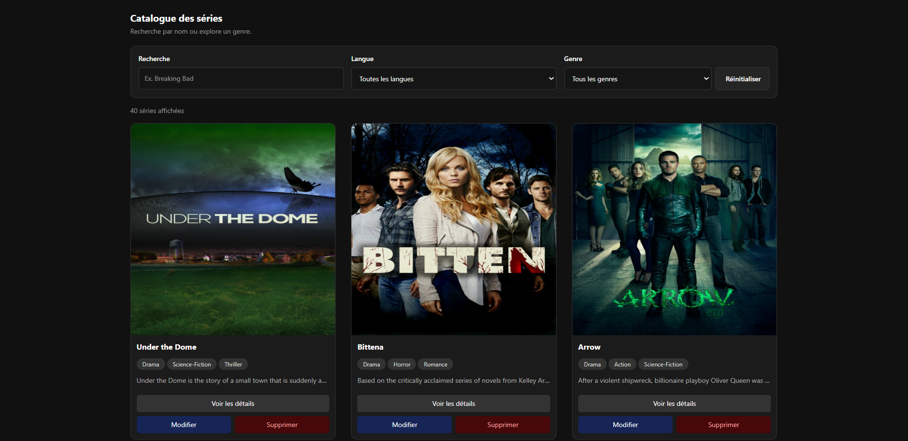
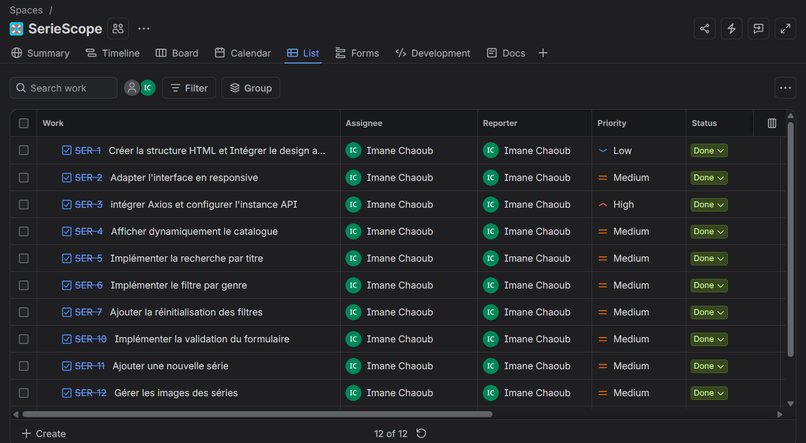

# 🎬 SérieScope — Catalogue de séries TV (2/2)

SérieScope est une application web réalisée par **Imane Chaoub**, dans le cadre de la formation **Développeur Web et Web Mobile — Simplon / YouCode**.

Cette deuxième partie du projet permet à une médiathèque de consulter, rechercher, ajouter, modifier et supprimer des séries. Les données sont enregistrées sur le serveur grâce à l’**API SérieScope** fournie dans le brief.

Le frontend utilise **JavaScript Vanilla**, **Axios** et **Tailwind CSS**. Les critères de recherche sont conservés dans le navigateur avec `localStorage`.

## Liens du projet

- [Dépôt GitHub](https://github.com/itsemmax/SerieScope)
- [Adresse du site](https://seriescope.vercel.app/)
- [Documentation Swagger de l’API SérieScope](https://seriescope-api.vercel.app/)

## Aperçu



Cette capture est conservée depuis la première version du projet.

## Fonctionnalités de cette version

### Catalogue et chargement

Les séries sont récupérées avec `GET /series` et affichées sous forme de cartes :

- affiche, titre, genres et résumé ;
- bouton **Voir les détails** ;
- bouton **Modifier** ;
- bouton **Supprimer**.

Le message **« Chargement des séries… »** apparaît pendant la récupération du catalogue. Si le serveur renvoie un tableau vide, l’application affiche **« Aucune série trouvée »**. Un message d’erreur apparaît si le chargement échoue, avec un message spécifique en cas de timeout.

La grille s’adapte à la largeur de l’écran : une colonne sur mobile, deux sur tablette et trois sur les grands écrans.

### Recherche et filtres côté serveur

Trois critères peuvent être combinés :

- `name` : recherche par nom ;
- `genre` : filtre par genre ;
- `language` : filtre par langue.

À chaque saisie ou sélection, les valeurs sont placées dans `state.filters`, puis transmises à Axios avec `params` :

```javascript
const response = await myax.get("/series", {
    params: filters
});
```

L’API effectue la recherche et le filtrage. Le tableau reçu sert à afficher les résultats.

Les choix de genres et de langues sont construits à partir du catalogue complet, sans doublons. Ils sont actualisés après un ajout, une modification ou une suppression et restent disponibles lorsqu’une recherche ne renvoie aucun résultat.

Le bouton **Réinitialiser** vide les trois critères, supprime leur sauvegarde locale et recharge le catalogue.

### Ajout et modification

Le même formulaire sert à ajouter une série et à modifier une série existante.

| Champ | Validation actuelle |
| --- | --- |
| Nom | Obligatoire, entre 2 et 60 caractères après suppression des espaces au début et à la fin. |
| Langue | Une langue doit être sélectionnée. |
| Genres | Au moins un genre ; valeurs séparées par des virgules, avec au moins 2 caractères par genre. Lettres, espaces, apostrophes et tirets acceptés. |
| Résumé | Facultatif. |
| Affiche | Facultative ; affichage local du fichier sélectionné. |

Les erreurs de validation côté navigateur sont affichées sous les champs concernés.

- **Ajouter** envoie une requête `POST /series`.
- **Modifier** préremplit le formulaire avec les données de la carte et affiche le mode édition.
- **Enregistrer les modifications** envoie une requête `PATCH /series/:id`.
- **Annuler** vide le formulaire et revient au mode ajout.

Exemple de données envoyées :

```json
{
    "name": "Ma série",
    "language": "French",
    "genres": ["Drama", "Comedy"],
    "summary": "Le résumé de la série."
}
```

`PATCH` permet de mettre à jour les champs du formulaire sans remplacer les autres informations de la fiche, comme les dates ou la note.

Après un enregistrement réussi, le formulaire est vidé. Sans filtre actif, le catalogue affiché est mis à jour à partir de la réponse de l’API. Avec des filtres actifs, une nouvelle requête récupère les résultats correspondants.

### Suppression

Le bouton **Supprimer** ouvre une confirmation avec le titre de la série :

```text
Voulez-vous supprimer "Nom de la série" ?
```

Après confirmation, l’application envoie `DELETE /series/:id`, puis recharge les choix des filtres et le catalogue. Si la suppression échoue, un message d’erreur apparaît et la carte n’est pas retirée par cette opération.

### Fiche détaillée

Le bouton **Voir les détails** ouvre une page dédiée :

```text
details.html?id=1
```

`ui/details.js` lit l’identifiant dans l’URL avec `URLSearchParams`, appelle `getById(id)`, puis remplit la page avec :

- le titre et l’affiche ;
- la date de première diffusion et la date de fin ;
- la note moyenne sur 10 ;
- le lien du site officiel, lorsqu’une adresse HTTPS est disponible ;
- le résumé.

Les balises HTML du résumé sont retirées avant l’affichage du texte. Des valeurs de remplacement sont utilisées pour les informations manquantes. Un lien permet de revenir au catalogue.

## API et service Axios

L’application active utilise une seule instance Axios, définie dans [src/api.js](./src/api.js) :

```javascript
export const myax = axios.create({
    baseURL: "https://seriescope-api.vercel.app/api",
    timeout: 8000,
    headers: { "X-Learner": "i.chaoub" }
});
```

Le délai maximal d’une requête est de **8 secondes**. L’en-tête `X-Learner` identifie l’espace de données de l’apprenant. Il faut conserver le même identifiant pour retrouver son catalogue, y compris depuis un autre navigateur.

Les appels sont regroupés dans [src/serieService.js](./src/serieService.js). Chaque fonction utilise `async/await` et `try/catch` ; les erreurs sont transmises au code qui appelle le service.

| Fonction | Méthode | Route | Utilisation |
| --- | --- | --- | --- |
| `getAll(filters)` | GET | `/series` | Lire le catalogue avec les critères envoyés dans `params`. |
| `getById(id)` | GET | `/series/:id` | Lire une série pour la page de détails. |
| `create(serie)` | POST | `/series` | Enregistrer une nouvelle série. |
| `update(id, serie)` | PATCH | `/series/:id` | Modifier une série. |
| `remove(id)` | DELETE | `/series/:id` | Supprimer une série. |

## État et persistance

[data/store.js](./data/store.js) contient l’état partagé :

```javascript
export const state = {
    series: [],
    filters: { name: "", genre: "", language: "" }
};
```

| Données | Emplacement | Après un rechargement |
| --- | --- | --- |
| Séries enregistrées | API SérieScope | Récupérées depuis le serveur. |
| Résultats affichés dans `state.series` | Mémoire du navigateur | Rechargés depuis l’API. |
| Critères de `state.filters` | `localStorage`, clé `filters` | Restaurés dans les champs et envoyés à l’API. |
| Affiche choisie dans le formulaire | URL temporaire locale | Non sauvegardée sur le serveur. |

Les critères sont enregistrés avec :

```javascript
localStorage.setItem("filters", JSON.stringify(state.filters));
```

Ils sont relus avec `JSON.parse()` au chargement. **Réinitialiser** supprime la clé avec `localStorage.removeItem("filters")`.

Cette sauvegarde des filtres appartient au navigateur et à l’adresse du site utilisés. Elle n’est pas synchronisée entre plusieurs navigateurs.

### Limite concernant les images

Le formulaire utilise `URL.createObjectURL()` pour afficher une image sélectionnée. La propriété `image` est retirée avant l’envoi du `POST` ou du `PATCH` : aucun fichier n’est téléversé vers l’API.

Cette affiche locale peut donc disparaître lors d’une nouvelle lecture du catalogue ou d’un changement de page. Les images déjà fournies par l’API restent utilisables. Le fichier `assets/images/image.png` sert de remplacement lorsqu’aucune affiche n’est disponible.

Le champ accepte les extensions JPG, JPEG, PNG et WEBP. La limite de **2 Mo** indiquée dans le formulaire n’est pas encore contrôlée par le JavaScript.

## Structure actuelle du projet

```text
SerieScope/
├── index.html
├── details.html
├── main.js
├── src/
│   ├── api.js
│   └── serieService.js
├── data/
│   └── store.js
├── ui/
│   ├── cards.js
│   ├── form.js
│   ├── filters.js
│   ├── notify.js
│   └── details.js
├── js/
│   └── script.js
├── assets/
│   └── images/
│       ├── catalogue.png
│       ├── image.png
│       └── jira.png
└── README.md
```

| Fichier | Rôle |
| --- | --- |
| [index.html](./index.html) | Formulaire, filtres, catalogue et messages. |
| [main.js](./main.js) | Chargement du catalogue, événements du formulaire et opérations d’ajout, modification et suppression. |
| [src/api.js](./src/api.js) | Configuration de l’instance Axios. |
| [src/serieService.js](./src/serieService.js) | Requêtes HTTP vers l’API. |
| [data/store.js](./data/store.js) | État partagé et restauration des filtres sauvegardés. |
| [ui/cards.js](./ui/cards.js) | Création et affichage des cartes. |
| [ui/form.js](./ui/form.js) | Validation, lecture, préremplissage et remise à zéro du formulaire. |
| [ui/filters.js](./ui/filters.js) | Choix des filtres, événements, sauvegarde locale et réinitialisation. |
| [ui/notify.js](./ui/notify.js) | Affichage et suppression des erreurs de validation près des champs. |
| [details.html](./details.html) et [ui/details.js](./ui/details.js) | Structure et chargement de la fiche détaillée. |
| [js/script.js](./js/script.js) | Ancienne version utilisant TVmaze, `fetch()` et une sauvegarde locale du catalogue. Son import est commenté. |

Le parcours principal est : **événement utilisateur → service Axios → API → `state.series` → affichage des cartes**.

L’ancienne pagination et l’ancienne modale restent dans `index.html`, mais elles ne sont pas utilisées par le JavaScript actif. Les détails s’ouvrent désormais dans `details.html`.

## Technologies

- **HTML5** et **Tailwind CSS v4** pour la structure et la mise en page responsive.
- **JavaScript Vanilla ES6+** et les modules ES pour le comportement de l’application.
- **Axios**, chargé par CDN, pour les requêtes HTTP.
- **API REST SérieScope** pour la persistance des séries.
- **localStorage** et **JSON** pour mémoriser les filtres.
- **Git / GitHub** pour le versionnement ; **Jira** pour l’organisation prévue dans le brief.

## Installation et lancement

1. Cloner le dépôt :

   ```bash
   git clone https://github.com/itsemmax/SerieScope.git
   cd SerieScope
   ```

2. Ouvrir le dossier dans Visual Studio Code.
3. Vérifier la valeur de `X-Learner` dans `src/api.js` pour utiliser l’espace souhaité.
4. Lancer `index.html` avec un serveur HTTP local, par exemple l’extension **Live Server**.

Il n’y a pas de dépendances npm à installer ni de compilation à lancer. Axios et Tailwind sont chargés par CDN. Une connexion Internet est nécessaire pour charger ces bibliothèques, accéder à l’API et récupérer les affiches distantes.

Ouvrir le projet avec le serveur local plutôt qu’en double-cliquant sur le fichier HTML, car le code utilise des modules JavaScript.

## Organisation du travail

Le brief prévoit de poursuivre le dépôt SérieScope existant avec :

- `main` pour la version stable ;
- `develop` pour l’intégration ;
- une branche par fonctionnalité, créée depuis `develop` ;
- une Pull Request par branche vers `develop`, avec des commits clairs ;
- une mise à jour des tâches dans Jira.

Exemples de branches : `feature/axios-service`, `feature/server-filters`, `feature/add-serie`, `feature/edit-serie` et `feature/delete-serie`.

### Capture du tableau Jira

<!-- Remplacer assets/images/jira.png par une capture à jour du tableau Jira. -->



## Vérifications manuelles à effectuer

Ces scénarios servent à contrôler la version et à préparer la démonstration ; ils ne constituent pas un rapport de tests déjà exécutés.

1. Ouvrir l’onglet **Réseau** des DevTools et vérifier les appels à `/api/series`, leurs méthodes et l’en-tête `X-Learner`.
2. Combiner recherche, genre et langue ; vérifier les paramètres dans l’URL et le message lorsque la réponse est vide.
3. Recharger la page : les critères doivent rester remplis. Utiliser **Réinitialiser**, puis recharger pour vérifier leur suppression.
4. Essayer un formulaire invalide, puis ajouter une série valide. Recharger la page pour vérifier sa présence dans l’API.
5. Modifier une série, vérifier le `PATCH`, puis recharger. Tester également **Annuler**.
6. Annuler une suppression, puis en confirmer une et vérifier le `DELETE` ainsi que la disparition de la série après rechargement.
7. Ouvrir une fiche détaillée ; tester aussi une URL sans identifiant et un identifiant inexistant.
8. Simuler un réseau lent et le mode hors ligne dans les DevTools pour observer les messages de chargement et d’erreur.
9. Vérifier la navigation au clavier et l’affichage sur mobile, tablette et ordinateur.

## Cadre pédagogique

**Brief :** SérieScope — Catalogue de séries (2/2), connexion d’une application Web à des services et données externes.

- Travail individuel.
- Durée annoncée : **4 jours**, environ **20 heures**.
- Lancement prévu : **16 novembre 2026**.
- Rendu prévu : **20 novembre 2026 à 17 h**.
- Évaluation : **15 minutes** de présentation — démonstration, explication du code et questions — puis **45 minutes** de mise en situation.
