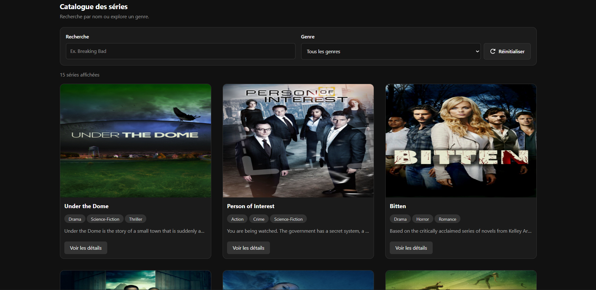
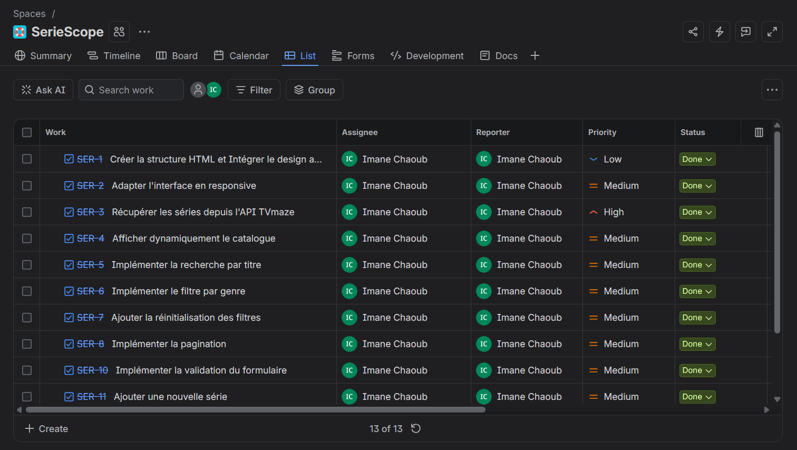

# 🎬 SérieScope — Catalogue de séries TV

SérieScope est une application web développée dans le cadre d'un projet individuel à **Simplon / YouCode**.

Ce projet répond au besoin d'une médiathèque souhaitant mettre à disposition de ses visiteurs un catalogue en ligne de séries et de documentaires.

L'application permet de consulter les séries, rechercher un titre, filtrer par genre, ajouter de nouvelles séries et afficher leurs informations détaillées.

Le catalogue initial est alimenté par l'API **TVmaze**.

L'application fonctionne entièrement côté **frontend**, sans backend ni base de données.

---

## 📸 Aperçu du projet

### Catalogue des séries



L'application présente les séries sous forme de cartes contenant une affiche, un titre, des genres et une description.

L'utilisateur peut rechercher une série, filtrer le catalogue, naviguer entre les pages, ajouter une nouvelle série et consulter sa fiche détaillée.

---

## 🎯 Objectif du projet

L'objectif principal est de développer un catalogue de séries dynamique avec **JavaScript Vanilla ES6+**, en exploitant une API REST.

Ce projet permet notamment de pratiquer :

- la manipulation du DOM ;
- la gestion des événements JavaScript ;
- la récupération des données avec `fetch()` ;
- l'utilisation de `async/await` ;
- la manipulation des tableaux et des objets imbriqués ;
- l'exploitation des données JSON ;
- la recherche et le filtrage ;
- la pagination ;
- la validation des formulaires ;
- l'ajout dynamique de données ;
- l'utilisation de `localStorage` ;
- le responsive design avec Tailwind CSS ;
- la gestion de projet avec GitFlow et Jira.

---

## ✨ Fonctionnalités

### 📺 Affichage du catalogue

Au chargement de l'application, les séries sont récupérées depuis l'API TVmaze ou depuis les données déjà enregistrées dans `localStorage`.

Chaque carte affiche :

- l'affiche de la série ;
- le titre ;
- les genres sous forme de badges ;
- une courte description ;
- un bouton **Voir les détails**.

Les cartes sont générées dynamiquement avec JavaScript grâce à la manipulation du DOM.

### 🔗 Récupération des données depuis l'API

L'application utilise l'API publique TVmaze :

`https://api.tvmaze.com/shows?page=0`

Les données sont récupérées avec `fetch()` et `async/await`.

La fonction vérifie la réponse HTTP grâce à `response.ok`.

Les erreurs sont gérées avec `try...catch` et un message est affiché en cas d'échec de récupération.

Les données récupérées sont conservées dans un tableau JavaScript et enregistrées dans `localStorage`.

### 🔎 Recherche par titre

L'utilisateur peut rechercher une série en saisissant une partie de son nom.

La recherche :

- fonctionne en temps réel ;
- ignore les majuscules et les minuscules ;
- accepte les noms partiels ;
- se combine avec le filtre par genre ;
- actualise automatiquement les cartes affichées.

La recherche utilise notamment les méthodes :

- `filter()`
- `includes()`
- `toLowerCase()`

### 🏷️ Filtrage par genre

Les genres sont récupérés dynamiquement à partir des séries du catalogue.

L'utilisateur peut :

- sélectionner un genre ;
- afficher les séries correspondant au genre sélectionné ;
- combiner le filtre avec la recherche ;
- sélectionner **Tous les genres** pour afficher toutes les séries.

Une série possédant plusieurs genres peut apparaître dans plusieurs catégories.

### 🔄 Réinitialisation des filtres

Un bouton **Réinitialiser** permet de :

- vider le champ de recherche ;
- supprimer le filtre par genre ;
- réafficher le catalogue complet.

Si aucune série ne correspond aux critères sélectionnés, le message suivant apparaît :

**Aucune série trouvée**

### 📄 Pagination

Le catalogue utilise une pagination pour faciliter la navigation.

Chaque page affiche au maximum **15 séries**.

L'utilisateur peut :

- passer à la page suivante ;
- revenir à la page précédente ;
- consulter le numéro de la page actuelle ;
- connaître le nombre total de pages.

Les boutons sont désactivés lorsqu'il n'est plus possible d'avancer ou de reculer.

La pagination utilise notamment :

- `slice()` pour sélectionner les séries de la page ;
- `Math.ceil()` pour calculer le nombre total de pages.

### ➕ Ajout d'une série

Un formulaire permet d'ajouter une nouvelle série au catalogue.

Les champs proposés sont :

- nom de la série ;
- genre(s) séparés par des virgules ;
- affiche de la série ;
- description facultative.

Lorsqu'un ajout est valide :

1. Un nouvel objet JavaScript est créé.
2. La série est ajoutée au début du tableau.
3. Les données sont enregistrées dans `localStorage`.
4. Le catalogue est actualisé sans rechargement.
5. Le formulaire est réinitialisé.

Le filtre et la recherche actifs sont réappliqués après l'ajout.

### 📝 Validation du formulaire

Les informations sont vérifiées avant l'ajout d'une série.

**Nom de la série :**

- champ obligatoire ;
- entre 2 et 60 caractères ;
- les espaces seuls sont refusés.

**Genres :**

- au moins un genre obligatoire ;
- plusieurs genres peuvent être séparés par des virgules ;
- chaque genre doit contenir au moins 2 caractères ;
- les genres doivent respecter le format autorisé.

**Image :**

- une image est obligatoire ;
- taille maximale de 2 Mo ;
- le champ de sélection accepte les formats JPG, JPEG, PNG et WEBP.

Des messages d'erreur sont affichés sous les champs concernés.

Les bordures deviennent rouges lorsqu'une erreur est détectée.

### 🖼️ Gestion des images

Les affiches des séries récupérées depuis TVmaze proviennent des URLs fournies par l'API.

Pour les séries ajoutées depuis le formulaire, l'application utilise :

`URL.createObjectURL(fichier)`

Cette méthode permet d'afficher immédiatement l'image sélectionnée dans le navigateur.

**Limitation :** les URLs temporaires créées avec `URL.createObjectURL()` ne restent pas valides après un rechargement de la page. Les images ajoutées ne sont donc pas sauvegardées durablement avec le système actuel.

### 📋 Fiche détaillée

Chaque carte possède un bouton **Voir les détails** permettant d'afficher les informations complémentaires d'une série dans une fenêtre modale.

La fiche détaillée contient :

- le titre de la série ;
- son affiche ;
- sa note moyenne ;
- ses jours de diffusion ;
- son heure de diffusion ;
- sa chaîne de diffusion ;
- le pays de la chaîne ;
- sa description complète.

Les informations sont récupérées depuis les propriétés imbriquées des objets fournis par l'API TVmaze :

- `serie.rating.average`
- `serie.schedule.days`
- `serie.schedule.time`
- `serie.network.name`
- `serie.network.country.name`
- `serie.summary`

Lorsqu'une information est absente, le message **Non renseigné** est affiché.

La description est nettoyée des balises HTML grâce à la méthode `replace()` afin d'afficher uniquement le texte.

La fenêtre modale est responsive et permet de faire défiler son contenu lorsque celui-ci dépasse la hauteur de l'écran, tout en masquant la barre de défilement.

L'utilisateur peut fermer la fiche avec les boutons de fermeture ou la touche `Échap`.

### 💾 Sauvegarde locale

Les données des séries sont enregistrées dans `localStorage` sous la clé :

`"series"`

Les données sont sauvegardées et récupérées avec :

- `JSON.stringify()`
- `JSON.parse()`

Cela permet de conserver les informations des séries après un rafraîchissement de la page.

La persistance des affiches ajoutées reste limitée par l'utilisation des URLs temporaires.

---

## 🛠️ Technologies utilisées

- **HTML5** — structure sémantique de l'application
- **Tailwind CSS v4** — design et responsive
- **JavaScript Vanilla ES6+** — logique de l'application
- **DOM** — manipulation dynamique des éléments
- **Fetch API** — récupération des séries
- **TVmaze API** — source des données
- **JSON** — format des données
- **localStorage** — sauvegarde locale
- **Font Awesome** — icônes
- **Git** — gestion des versions
- **GitHub** — hébergement du code source
- **GitFlow** — organisation des branches
- **Jira** — gestion des tâches
- **Figma** — conception des maquettes

---

## 📁 Structure du projet

```text
SerieScope/
│
├── index.html
│
├── js/
│   └── script.js
│
├── assets/
│   └── images/
│       ├── catalogue.png
│       └── jira.png
│
└── README.md
```

Les fichiers d'images présentés dans cette structure correspondent aux captures d'écran à ajouter pour la documentation.

### Rôle des fichiers

**`index.html`**

Contient la structure HTML de l'application :

- header ;
- formulaire d'ajout ;
- recherche et filtre ;
- catalogue des séries ;
- pagination ;
- fiche détaillée ;
- footer.

**`js/script.js`**

Contient la logique JavaScript :

- récupération des séries depuis l'API ;
- génération dynamique des cartes ;
- affichage des genres ;
- recherche et filtrage ;
- pagination ;
- validation du formulaire ;
- ajout d'une série ;
- gestion des images ;
- affichage de la fiche détaillée ;
- sauvegarde locale.

**`README.md`**

Présente le projet, ses fonctionnalités, les technologies utilisées et les instructions de lancement.

---

## 🌐 API TVmaze

SérieScope utilise l'API publique TVmaze pour récupérer les informations des séries.

**Endpoint utilisé :**

`GET https://api.tvmaze.com/shows?page=0`

### Exemple de structure JSON

```javascript
{
    id: 1,
    name: "Example Series",
    language: "English",
    genres: ["Drama", "Comedy"],
    status: "Running",
    rating: {
        average: 8.5
    },
    schedule: {
        time: "20:00",
        days: ["Monday"]
    },
    network: {
        name: "Example Network",
        country: {
            name: "United States"
        }
    },
    image: {
        medium: "https://example.com/image.jpg",
        original: "https://example.com/image-original.jpg"
    },
    summary: "Description de la série"
}
```

Cet objet est un exemple illustratif de la structure des données.

### Récupération des données

```javascript
async function recupererSeries() {
    try {
        const response = await fetch(
            "https://api.tvmaze.com/shows?page=0"
        );

        if (!response.ok) {
            throw new Error(
                "Erreur lors de la récupération des séries"
            );
        }

        const data = await response.json();

        series = data;

        localStorage.setItem(
            "series",
            JSON.stringify(series)
        );

        afficher(series);

    } catch (error) {
        message_erreur_api.textContent =
            "Impossible de charger les séries.";

        message_erreur_api.hidden = false;

        console.error(error);
    }
}
```

---

## 💾 Gestion des données

Les séries sont représentées sous forme d'un tableau d'objets JavaScript.

```javascript
let series = [];
```

Les données sont récupérées depuis l'API et enregistrées dans `localStorage`.

Lorsqu'une série est ajoutée, un nouvel objet est créé :

```javascript
let nouvelleSerie = {
    id: id_serie++,
    name: titre.value.trim(),
    genres: genre_serie.value
        .split(",")
        .map((genre) => genre.trim()),
    summary: description.value.trim(),
    image: {
        original: URL.createObjectURL(fichier)
    }
};
```

La série est ensuite ajoutée au début du tableau :

```javascript
series.unshift(nouvelleSerie);
```

Le catalogue est actualisé dynamiquement.

---

## 🔀 Organisation avec GitFlow

Le développement du projet est organisé avec GitFlow.

### Branches principales

- `main` : version stable du projet
- `develop` : branche d'intégration des fonctionnalités

### Branches de fonctionnalités

Exemples :

```text
feature/layout
feature/responsive
feature/fetch-shows
feature/display-shows
feature/search-shows
feature/filter-by-genre
feature/pagination
feature/add-show
feature/form-validation
feature/local-storage
feature/show-details
```

Les fonctionnalités sont développées dans des branches dédiées avant leur intégration par Pull Requests.

---

## 📊 Organisation avec Jira

Le projet utilise **Jira** pour organiser et suivre les tâches de développement.



Les tâches sont réparties entre :

- initialisation du projet ;
- conception des maquettes Figma ;
- structure HTML ;
- intégration Tailwind CSS ;
- responsive design ;
- récupération des données TVmaze ;
- affichage dynamique des séries ;
- recherche par titre ;
- filtrage par genre ;
- réinitialisation des filtres ;
- pagination ;
- formulaire d'ajout ;
- validation des champs ;
- ajout dynamique d'une série ;
- gestion des images ;
- sauvegarde locale ;
- fiche détaillée ;
- tests et corrections ;
- documentation et déploiement.

Les statuts utilisés sont :

- À faire
- En cours
- En revue
- Terminé

---

## 🚀 Installation et lancement

### 1. Cloner le dépôt

```bash
git clone URL_DU_DEPOT_GITHUB
```

### 2. Accéder au projet

```bash
cd SerieScope
```

### 3. Lancer un serveur local

Il est recommandé d'utiliser **Live Server** dans Visual Studio Code.

### 4. Ouvrir l'application

```text
index.html
```

L'application charge les séries depuis l'API TVmaze lors de la première récupération.

Une connexion Internet est nécessaire pour accéder à l'API et charger Tailwind CSS et Font Awesome depuis leurs CDN.

---

## 🌐 Déploiement

L'application SérieScope peut être déployée sur Vercel.

🔗 **Application déployée :** [(https://seriescope.vercel.app/)]

🔗 **Dépôt GitHub :** [(https://github.com/itsemmax/SerieScope)]

---

## 📱 Responsive Design

L'interface est conçue pour s'adapter aux différents formats d'écran :

- 📱 Mobile
- 📲 Tablette
- 💻 Desktop

Tailwind CSS permet d'adapter :

- la grille des cartes ;
- les champs du formulaire ;
- les filtres ;
- les boutons ;
- la pagination ;
- la fenêtre modale ;
- les espacements et les tailles des éléments.

La grille affiche :

- 1 colonne sur mobile ;
- 2 colonnes sur tablette ;
- 3 colonnes sur les grands écrans.

---

## 🧠 Compétences développées

Ce projet m'a permis de pratiquer et de renforcer :

- JavaScript Vanilla ES6+ ;
- manipulation du DOM ;
- création dynamique d'éléments HTML ;
- événements avec `addEventListener()` ;
- récupération de données avec `fetch()` ;
- programmation asynchrone avec `async/await` ;
- gestion des erreurs avec `try...catch` ;
- manipulation des objets imbriqués ;
- manipulation des tableaux avec `forEach()`, `filter()`, `map()`, `some()` et `slice()` ;
- utilisation de `includes()` ;
- recherche et filtrage combinés ;
- pagination ;
- validation des formulaires ;
- gestion des fichiers avec `URL.createObjectURL()` ;
- sauvegarde avec `JSON.stringify()` ;
- récupération avec `JSON.parse()` ;
- utilisation de `localStorage` ;
- affichage des informations manquantes avec des valeurs de remplacement ;
- nettoyage des balises HTML avec `replace()` ;
- création d'une fenêtre modale responsive avec `<dialog>` ;
- gestion du défilement et de la fermeture d'une fenêtre modale ;
- responsive design avec Tailwind CSS ;
- GitFlow et Pull Requests ;
- organisation des tâches avec Jira.

---

## 👩‍💻 Réalisation

Projet réalisé individuellement dans le cadre de la formation **Développeur Web et Web Mobile**.

**Projet :** SérieScope — Catalogue de séries TV

**Contexte :** Simplon / YouCode

**Durée :** 5 jours

**Date de lancement :** 09 novembre 2026

**Date de rendu :** 13 novembre 2026
